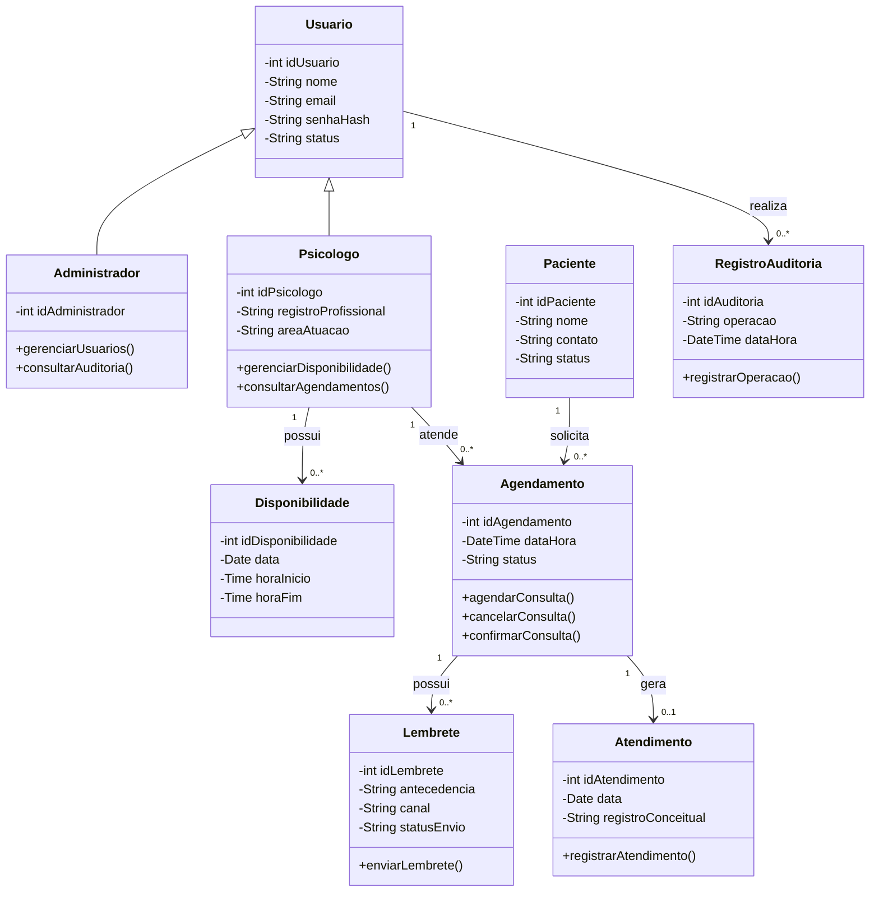
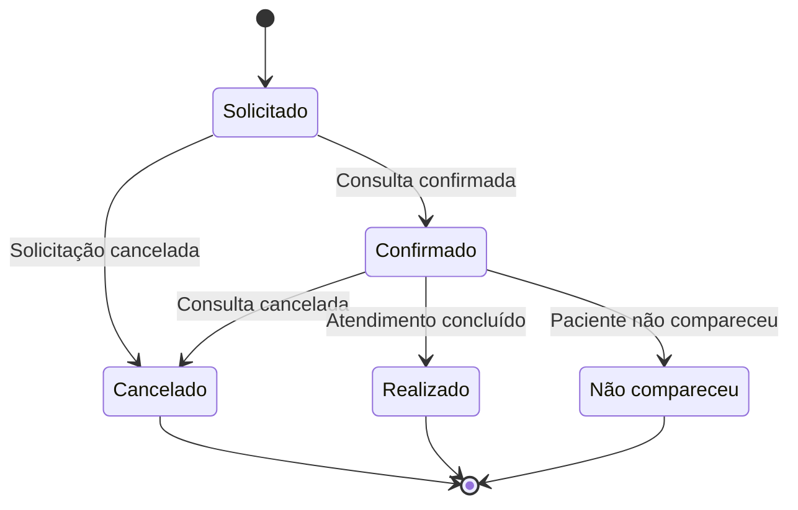
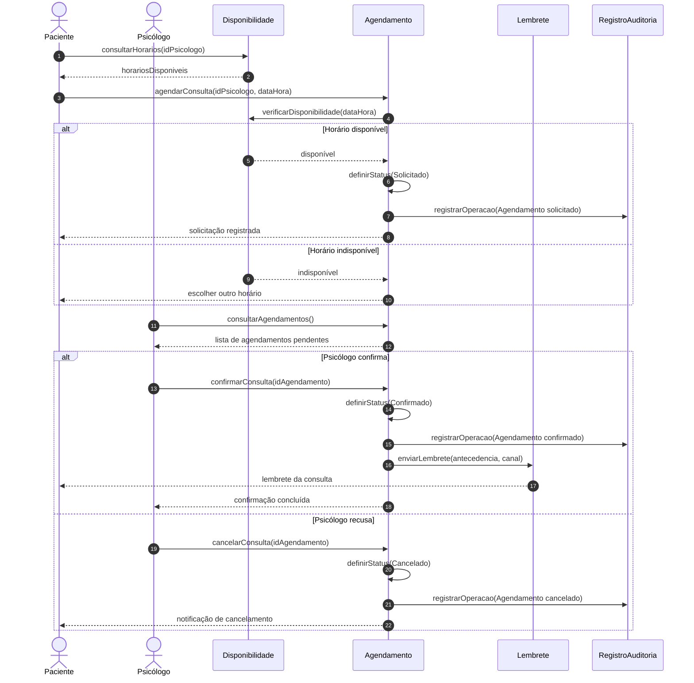
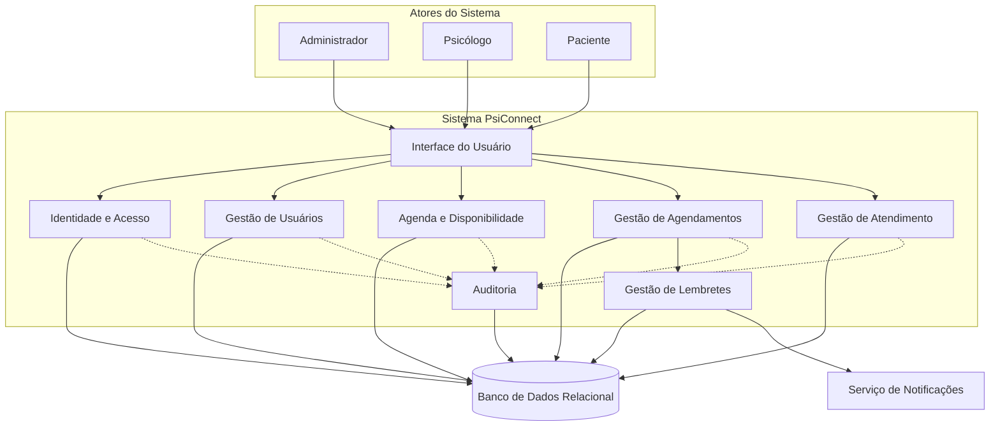
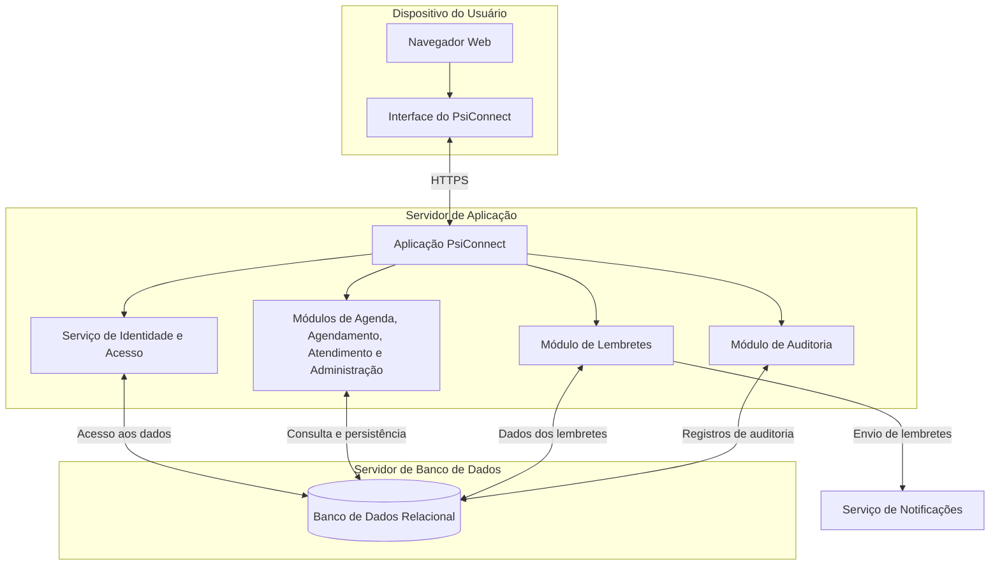

# AV3-PsiConnect

Projeto acadêmico desenvolvido para a avaliação AV3 da disciplina de Análise Orientada a Objetos.

O **PsiConnect** é uma proposta de plataforma voltada à organização de informações de psicólogos, pacientes, disponibilidades, agendamentos, atendimentos e lembretes de consultas.

Este repositório contém os diagramas utilizados na modelagem conceitual do projeto.

---

## 1. Diagrama de Classes

O diagrama de classes representa a estrutura do PsiConnect, suas classes, atributos, operações e relacionamentos.

---

## 2. Diagrama de Estados — Agendamento

O diagrama de estados representa o ciclo de vida de um agendamento, desde a solicitação até sua confirmação, cancelamento, realização ou registro de não comparecimento.

---

## 3. Diagrama de Sequência — Agendar e Confirmar Consulta

O diagrama de sequência representa a ordem temporal das mensagens trocadas entre os participantes e objetos envolvidos no processo de agendamento.

---

## 4. Diagrama de Comunicação — Agendar e Confirmar Consulta

O diagrama de comunicação representa os objetos envolvidos e as mensagens trocadas durante o agendamento, utilizando mensagens numeradas para indicar a sequência lógica.

---

## 5. Diagrama de Componentes — PsiConnect

O diagrama de componentes apresenta os principais módulos funcionais do sistema e suas dependências.

---

## 6. Diagrama de Implantação — PsiConnect

O diagrama de implantação representa uma proposta de distribuição da plataforma entre o dispositivo do usuário, o servidor de aplicação e o servidor de banco de dados.

---
