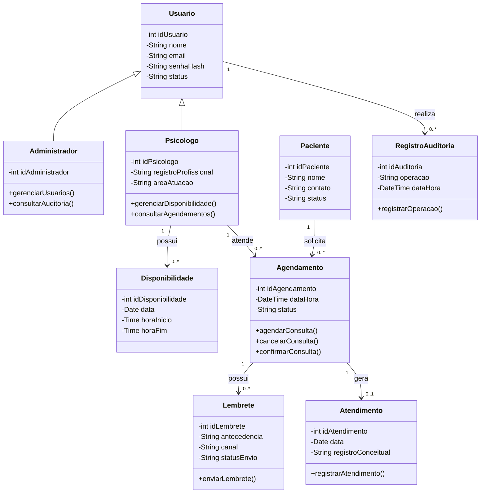
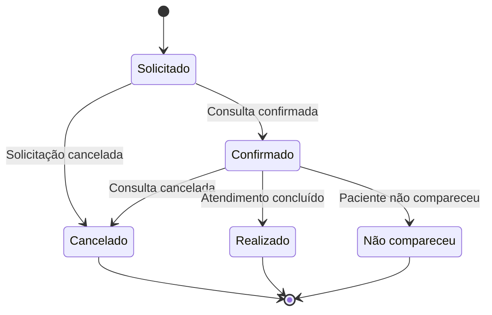

# AV3-PsiConnect

Projeto acadêmico desenvolvido para a avaliação AV3 da disciplina de Análise Orientada a Objetos.

O **PsiConnect** é uma proposta de plataforma voltada à organização de informações de psicólogos, pacientes, disponibilidades, agendamentos e lembretes de consultas.

## 1. Diagrama de Classes

O diagrama de classes representa a estrutura do PsiConnect, apresentando suas principais classes, atributos, operações e relacionamentos.

## 2. Diagrama de Estados — Agendamento

O diagrama de estados representa o ciclo de vida de um agendamento, desde a solicitação até sua confirmação, cancelamento, realização ou registro de não comparecimento.

