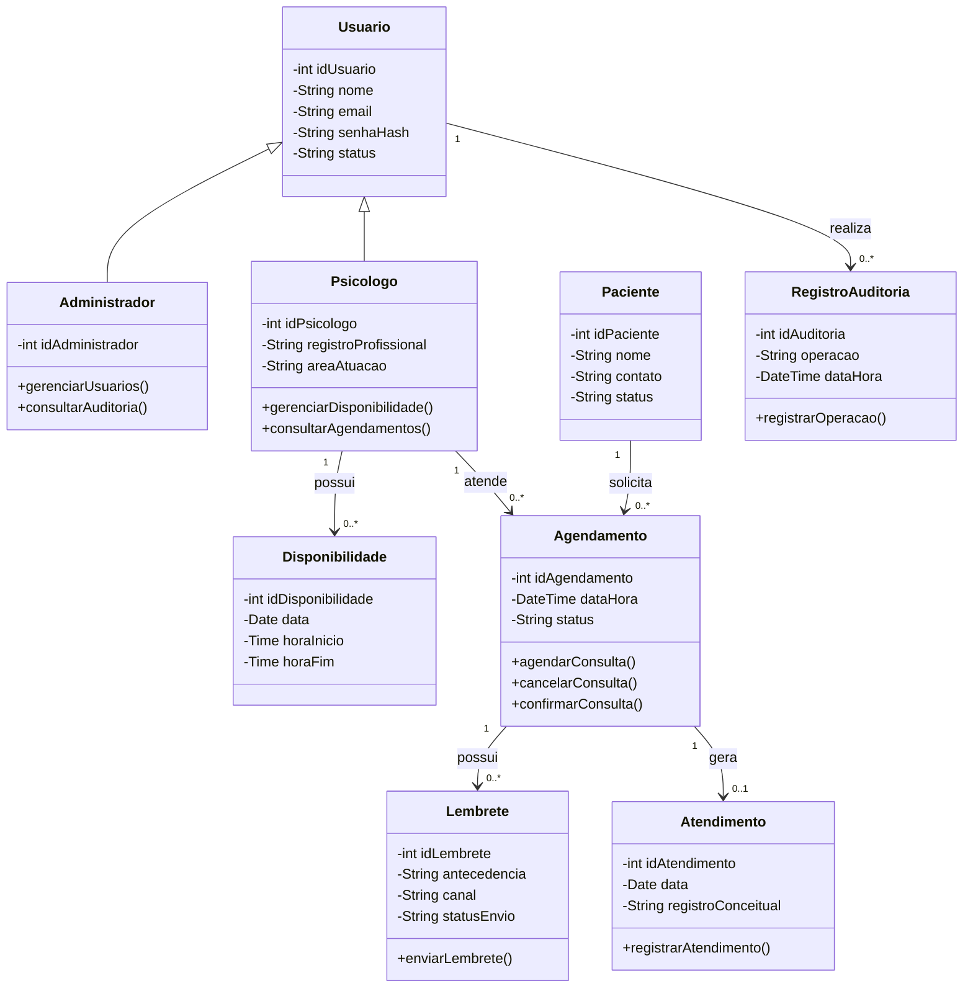
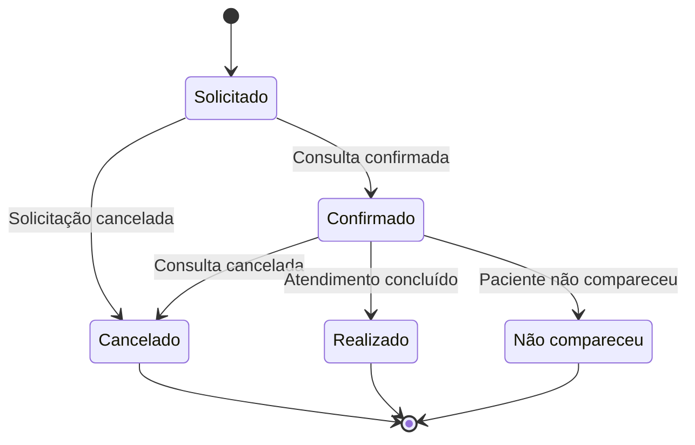
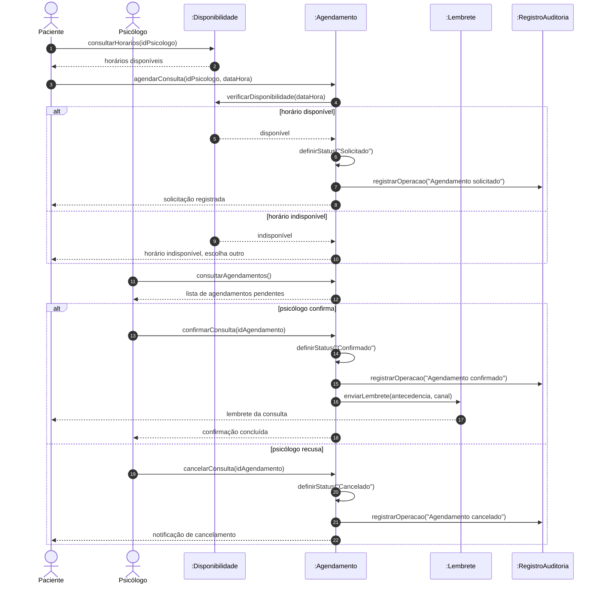
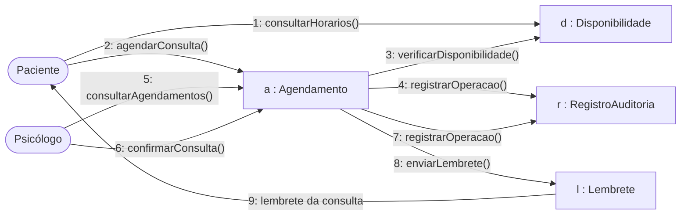

# AV3-PsiConnect

Projeto acadêmico desenvolvido para a avaliação AV3 da disciplina de Análise Orientada a Objetos.

O **PsiConnect** é uma proposta de plataforma voltada à organização de informações de psicólogos, pacientes, disponibilidades, agendamentos e lembretes de consultas.

## 1. Diagrama de Classes

O diagrama de classes representa a estrutura do PsiConnect, apresentando suas principais classes, atributos, operações e relacionamentos.

## 2. Diagrama de Estados — Agendamento

O diagrama de estados representa o ciclo de vida de um agendamento, desde a solicitação até sua confirmação, cancelamento, realização ou registro de não comparecimento.

## 3. Diagrama de Sequência — Agendar e Confirmar Consulta

O diagrama de sequência representa a ordem temporal das mensagens trocadas entre os objetos no cenário de agendamento e confirmação de uma consulta, incluindo a verificação de disponibilidade, a confirmação ou recusa pelo psicólogo e o envio do lembrete.

## 4. Diagrama de Comunicação — Agendar e Confirmar Consulta

O diagrama de comunicação representa o mesmo cenário do diagrama de sequência, enfatizando os vínculos entre os objetos e a numeração sequencial das mensagens. Como o Mermaid não possui sintaxe nativa para diagramas de comunicação, ele foi representado com `flowchart`, usando objetos como nós e mensagens numeradas nas setas.

Diagrama de Componentes

<mxfile host="app.diagrams.net">
  <diagram name="Diagrama de Componentes Completo" id="comp-diagram-full">
    <mxGraphModel dx="1200" dy="800" grid="1" gridSize="10" guides="1" tooltips="1" connect="1" arrows="1" fold="1" page="1" pageScale="1" pageWidth="1169" pageHeight="827" math="0" shadow="0">
      <root>
        <mxCell id="0"/>
        <mxCell id="1" parent="0"/>
        
        <!-- SUBSISTEMA FRONTEND -->
        <mxCell id="frontend_sub" value="«subsystem»&#10;&lt;b&gt;Camada de Apresentação (Frontend)&lt;/b&gt;" style="shape=module;align=left;spacingLeft=15;align=top;whiteSpace=wrap;html=1;fillColor=#f5f5f5;strokeColor=#666666;fontColor=#333333;collapsible=0;" vertex="1" parent="1">
          <mxGeometry x="40" y="80" width="260" height="360" as="geometry"/>
        </mxCell>
        <mxCell id="c_spa" value="«component»&#10;&lt;b&gt;SPA / Client Web&lt;/b&gt;&#10;(React / Vue / Angular)" style="html=1;dropTarget=0;whiteSpace=wrap;fillColor=#dae8fc;strokeColor=#6c8ebf;" vertex="1" parent="frontend_sub">
          <mxGeometry x="30" y="60" width="200" height="70" as="geometry"/>
        </mxCell>
        <mxCell id="c_ui_store" value="«component»&#10;&lt;b&gt;Estado do Cliente (Store)&lt;/b&gt;&#10;(Redux / Pinia)" style="html=1;dropTarget=0;whiteSpace=wrap;fillColor=#dae8fc;strokeColor=#6c8ebf;" vertex="1" parent="frontend_sub">
          <mxGeometry x="30" y="160" width="200" height="70" as="geometry"/>
        </mxCell>
        <mxCell id="c_http_client" value="«component»&#10;&lt;b&gt;Cliente HTTP / Axios&lt;/b&gt;" style="html=1;dropTarget=0;whiteSpace=wrap;fillColor=#dae8fc;strokeColor=#6c8ebf;" vertex="1" parent="frontend_sub">
          <mxGeometry x="30" y="260" width="200" height="70" as="geometry"/>
        </mxCell>
        
        <!-- SUBSISTEMA BACKEND API -->
        <mxCell id="backend_sub" value="«subsystem»&#10;&lt;b&gt;Camada de Serviços / Backend API&lt;/b&gt;" style="shape=module;align=left;spacingLeft=15;align=top;whiteSpace=wrap;html=1;fillColor=#f5f5f5;strokeColor=#666666;fontColor=#333333;collapsible=0;" vertex="1" parent="1">
          <mxGeometry x="360" y="80" width="460" height="520" as="geometry"/>
        </mxCell>
        <mxCell id="c_api_gateway" value="«component»&#10;&lt;b&gt;API Gateway / Controllers&lt;/b&gt;&#10;(Roteamento, CORS, Auth Guard)" style="html=1;dropTarget=0;whiteSpace=wrap;fillColor=#d5e8d4;strokeColor=#82b366;" vertex="1" parent="backend_sub">
          <mxGeometry x="40" y="60" width="380" height="70" as="geometry"/>
        </mxCell>
        <mxCell id="c_user_service" value="«component»&#10;&lt;b&gt;Serviço de Usuários&lt;/b&gt;&#10;(User Domain)" style="html=1;dropTarget=0;whiteSpace=wrap;fillColor=#ffe6cc;strokeColor=#d79b00;" vertex="1" parent="backend_sub">
          <mxGeometry x="40" y="180" width="170" height="80" as="geometry"/>
        </mxCell>
        <mxCell id="c_business_service" value="«component»&#10;&lt;b&gt;Serviço de Negócio Core&lt;/b&gt;&#10;(Regras da Aplicação)" style="html=1;dropTarget=0;whiteSpace=wrap;fillColor=#ffe6cc;strokeColor=#d79b00;" vertex="1" parent="backend_sub">
          <mxGeometry x="250" y="180" width="170" height="80" as="geometry"/>
        </mxCell>
        <mxCell id="c_orm" value="«component»&#10;&lt;b&gt;Módulo ORM / Repositórios&lt;/b&gt;&#10;(Mapeamento Objeto-Relacional)" style="html=1;dropTarget=0;whiteSpace=wrap;fillColor=#f8cecc;strokeColor=#b85450;" vertex="1" parent="backend_sub">
          <mxGeometry x="40" y="320" width="380" height="70" as="geometry"/>
        </mxCell>
        <mxCell id="c_cache_manager" value="«component»&#10;&lt;b&gt;Gerenciador de Cache&lt;/b&gt;&#10;(Redis / Memory)" style="html=1;dropTarget=0;whiteSpace=wrap;fillColor=#e1d5e7;strokeColor=#9673a6;" vertex="1" parent="backend_sub">
          <mxGeometry x="40" y="420" width="380" height="60" as="geometry"/>
        </mxCell>

        <!-- EXTERNAL SERVICES & BANCO -->
        <mxCell id="c_db" value="«database»&#10;&lt;b&gt;Banco de Dados Relacional&lt;/b&gt;&#10;(PostgreSQL / MySQL)" style="shape=cylinder3;whiteSpace=wrap;html=1;boundedLbl=1;backgroundOutline=1;size=15;fillColor=#ffe6cc;strokeColor=#d79b00;" vertex="1" parent="1">
          <mxGeometry x="900" y="380" width="190" height="110" as="geometry"/>
        </mxCell>
        <mxCell id="c_ext_auth" value="«component»&#10;&lt;b&gt;Provedor de Auth Externo&lt;/b&gt;&#10;(OAuth2 / Auth0 / Keycloak)" style="html=1;dropTarget=0;whiteSpace=wrap;fillColor=#e1d5e7;strokeColor=#9673a6;" vertex="1" parent="1">
          <mxGeometry x="900" y="140" width="190" height="80" as="geometry"/>
        </mxCell>

        <!-- INTERFACES DE COMUNICAÇÃO -->
        <mxCell id="i_rest" value="REST / HTTPS" style="shape=ellipse;whiteSpace=wrap;html=1;fillColor=#ffffff;strokeColor=#000000;fontSize=10;" vertex="1" parent="1">
          <mxGeometry x="305" y="160" width="50" height="50" as="geometry"/>
        </mxCell>
        <mxCell id="i_sql" value="SQL / Driver BD" style="shape=ellipse;whiteSpace=wrap;html=1;fillColor=#ffffff;strokeColor=#000000;fontSize=10;" vertex="1" parent="1">
          <mxGeometry x="830" y="410" width="50" height="50" as="geometry"/>
        </mxCell>

        <!-- RELACIONAMENTOS -->
        <mxCell id="rel1" edge="1" parent="1" source="c_spa" target="c_ui_store" style="dashed=1;endArrow=open;endSize=8;html=1;">
          <mxGeometry relative="1" as="geometry"/>
        </mxCell>
        <mxCell id="rel2" edge="1" parent="1" source="c_ui_store" target="c_http_client" style="dashed=1;endArrow=open;endSize=8;html=1;">
          <mxGeometry relative="1" as="geometry"/>
        </mxCell>
        <mxCell id="rel3" edge="1" parent="1" source="c_http_client" target="i_rest" style="endArrow=none;html=1;">
          <mxGeometry relative="1" as="geometry"/>
        </mxCell>
        <mxCell id="rel4" edge="1" parent="1" source="i_rest" target="c_api_gateway" style="endArrow=open;endSize=8;html=1;">
          <mxGeometry relative="1" as="geometry"/>
        </mxCell>
        <mxCell id="rel5" edge="1" parent="1" source="c_api_gateway" target="c_user_service" style="dashed=1;endArrow=open;endSize=8;html=1;">
          <mxGeometry relative="1" as="geometry"/>
        </mxCell>
        <mxCell id="rel6" edge="1" parent="1" source="c_api_gateway" target="c_business_service" style="dashed=1;endArrow=open;endSize=8;html=1;">
          <mxGeometry relative="1" as="geometry"/>
        </mxCell>
        <mxCell id="rel7" edge="1" parent="1" source="c_user_service" target="c_orm" style="dashed=1;endArrow=open;endSize=8;html=1;">
          <mxGeometry relative="1" as="geometry"/>
        </mxCell>
        <mxCell id="rel8" edge="1" parent="1" source="c_business_service" target="c_orm" style="dashed=1;endArrow=open;endSize=8;html=1;">
          <mxGeometry relative="1" as="geometry"/>
        </mxCell>
        <mxCell id="rel9" edge="1" parent="1" source="c_orm" target="c_cache_manager" style="dashed=1;endArrow=open;endSize=8;html=1;">
          <mxGeometry relative="1" as="geometry"/>
        </mxCell>
        <mxCell id="rel10" edge="1" parent="1" source="c_orm" target="i_sql" style="dashed=1;endArrow=open;endSize=8;html=1;">
          <mxGeometry relative="1" as="geometry"/>
        </mxCell>
        <mxCell id="rel11" edge="1" parent="1" source="i_sql" target="c_db" style="endArrow=none;html=1;">
          <mxGeometry relative="1" as="geometry"/>
        </mxCell>
        <mxCell id="rel12" edge="1" parent="1" source="c_api_gateway" target="c_ext_auth" style="dashed=1;endArrow=open;endSize=8;html=1;entryX=0;entryY=0.5;entryDx=0;entryDy=0;" edgeStyle="orthogonalEdgeStyle">
          <mxGeometry relative="1" as="geometry"/>
        </mxCell>
      </root>
    </mxGraphModel>
  </diagram>
</mxfile>

Diagrama de Implantaçção

<mxfile host="app.diagrams.net">
  <diagram name="Diagrama de Componentes Completo" id="comp-diagram-full">
    <mxGraphModel dx="1200" dy="800" grid="1" gridSize="10" guides="1" tooltips="1" connect="1" arrows="1" fold="1" page="1" pageScale="1" pageWidth="1169" pageHeight="827" math="0" shadow="0">
      <root>
        <mxCell id="0"/>
        <mxCell id="1" parent="0"/>
        
        <!-- SUBSISTEMA FRONTEND -->
        <mxCell id="frontend_sub" value="«subsystem»&#10;&lt;b&gt;Camada de Apresentação (Frontend)&lt;/b&gt;" style="shape=module;align=left;spacingLeft=15;align=top;whiteSpace=wrap;html=1;fillColor=#f5f5f5;strokeColor=#666666;fontColor=#333333;collapsible=0;" vertex="1" parent="1">
          <mxGeometry x="40" y="80" width="260" height="360" as="geometry"/>
        </mxCell>
        <mxCell id="c_spa" value="«component»&#10;&lt;b&gt;SPA / Client Web&lt;/b&gt;&#10;(React / Vue / Angular)" style="html=1;dropTarget=0;whiteSpace=wrap;fillColor=#dae8fc;strokeColor=#6c8ebf;" vertex="1" parent="frontend_sub">
          <mxGeometry x="30" y="60" width="200" height="70" as="geometry"/>
        </mxCell>
        <mxCell id="c_ui_store" value="«component»&#10;&lt;b&gt;Estado do Cliente (Store)&lt;/b&gt;&#10;(Redux / Pinia)" style="html=1;dropTarget=0;whiteSpace=wrap;fillColor=#dae8fc;strokeColor=#6c8ebf;" vertex="1" parent="frontend_sub">
          <mxGeometry x="30" y="160" width="200" height="70" as="geometry"/>
        </mxCell>
        <mxCell id="c_http_client" value="«component»&#10;&lt;b&gt;Cliente HTTP / Axios&lt;/b&gt;" style="html=1;dropTarget=0;whiteSpace=wrap;fillColor=#dae8fc;strokeColor=#6c8ebf;" vertex="1" parent="frontend_sub">
          <mxGeometry x="30" y="260" width="200" height="70" as="geometry"/>
        </mxCell>
        
        <!-- SUBSISTEMA BACKEND API -->
        <mxCell id="backend_sub" value="«subsystem»&#10;&lt;b&gt;Camada de Serviços / Backend API&lt;/b&gt;" style="shape=module;align=left;spacingLeft=15;align=top;whiteSpace=wrap;html=1;fillColor=#f5f5f5;strokeColor=#666666;fontColor=#333333;collapsible=0;" vertex="1" parent="1">
          <mxGeometry x="360" y="80" width="460" height="520" as="geometry"/>
        </mxCell>
        <mxCell id="c_api_gateway" value="«component»&#10;&lt;b&gt;API Gateway / Controllers&lt;/b&gt;&#10;(Roteamento, CORS, Auth Guard)" style="html=1;dropTarget=0;whiteSpace=wrap;fillColor=#d5e8d4;strokeColor=#82b366;" vertex="1" parent="backend_sub">
          <mxGeometry x="40" y="60" width="380" height="70" as="geometry"/>
        </mxCell>
        <mxCell id="c_user_service" value="«component»&#10;&lt;b&gt;Serviço de Usuários&lt;/b&gt;&#10;(User Domain)" style="html=1;dropTarget=0;whiteSpace=wrap;fillColor=#ffe6cc;strokeColor=#d79b00;" vertex="1" parent="backend_sub">
          <mxGeometry x="40" y="180" width="170" height="80" as="geometry"/>
        </mxCell>
        <mxCell id="c_business_service" value="«component»&#10;&lt;b&gt;Serviço de Negócio Core&lt;/b&gt;&#10;(Regras da Aplicação)" style="html=1;dropTarget=0;whiteSpace=wrap;fillColor=#ffe6cc;strokeColor=#d79b00;" vertex="1" parent="backend_sub">
          <mxGeometry x="250" y="180" width="170" height="80" as="geometry"/>
        </mxCell>
        <mxCell id="c_orm" value="«component»&#10;&lt;b&gt;Módulo ORM / Repositórios&lt;/b&gt;&#10;(Mapeamento Objeto-Relacional)" style="html=1;dropTarget=0;whiteSpace=wrap;fillColor=#f8cecc;strokeColor=#b85450;" vertex="1" parent="backend_sub">
          <mxGeometry x="40" y="320" width="380" height="70" as="geometry"/>
        </mxCell>
        <mxCell id="c_cache_manager" value="«component»&#10;&lt;b&gt;Gerenciador de Cache&lt;/b&gt;&#10;(Redis / Memory)" style="html=1;dropTarget=0;whiteSpace=wrap;fillColor=#e1d5e7;strokeColor=#9673a6;" vertex="1" parent="backend_sub">
          <mxGeometry x="40" y="420" width="380" height="60" as="geometry"/>
        </mxCell>

        <!-- EXTERNAL SERVICES & BANCO -->
        <mxCell id="c_db" value="«database»&#10;&lt;b&gt;Banco de Dados Relacional&lt;/b&gt;&#10;(PostgreSQL / MySQL)" style="shape=cylinder3;whiteSpace=wrap;html=1;boundedLbl=1;backgroundOutline=1;size=15;fillColor=#ffe6cc;strokeColor=#d79b00;" vertex="1" parent="1">
          <mxGeometry x="900" y="380" width="190" height="110" as="geometry"/>
        </mxCell>
        <mxCell id="c_ext_auth" value="«component»&#10;&lt;b&gt;Provedor de Auth Externo&lt;/b&gt;&#10;(OAuth2 / Auth0 / Keycloak)" style="html=1;dropTarget=0;whiteSpace=wrap;fillColor=#e1d5e7;strokeColor=#9673a6;" vertex="1" parent="1">
          <mxGeometry x="900" y="140" width="190" height="80" as="geometry"/>
        </mxCell>

        <!-- INTERFACES DE COMUNICAÇÃO -->
        <mxCell id="i_rest" value="REST / HTTPS" style="shape=ellipse;whiteSpace=wrap;html=1;fillColor=#ffffff;strokeColor=#000000;fontSize=10;" vertex="1" parent="1">
          <mxGeometry x="305" y="160" width="50" height="50" as="geometry"/>
        </mxCell>
        <mxCell id="i_sql" value="SQL / Driver BD" style="shape=ellipse;whiteSpace=wrap;html=1;fillColor=#ffffff;strokeColor=#000000;fontSize=10;" vertex="1" parent="1">
          <mxGeometry x="830" y="410" width="50" height="50" as="geometry"/>
        </mxCell>

        <!-- RELACIONAMENTOS -->
        <mxCell id="rel1" edge="1" parent="1" source="c_spa" target="c_ui_store" style="dashed=1;endArrow=open;endSize=8;html=1;">
          <mxGeometry relative="1" as="geometry"/>
        </mxCell>
        <mxCell id="rel2" edge="1" parent="1" source="c_ui_store" target="c_http_client" style="dashed=1;endArrow=open;endSize=8;html=1;">
          <mxGeometry relative="1" as="geometry"/>
        </mxCell>
        <mxCell id="rel3" edge="1" parent="1" source="c_http_client" target="i_rest" style="endArrow=none;html=1;">
          <mxGeometry relative="1" as="geometry"/>
        </mxCell>
        <mxCell id="rel4" edge="1" parent="1" source="i_rest" target="c_api_gateway" style="endArrow=open;endSize=8;html=1;">
          <mxGeometry relative="1" as="geometry"/>
        </mxCell>
        <mxCell id="rel5" edge="1" parent="1" source="c_api_gateway" target="c_user_service" style="dashed=1;endArrow=open;endSize=8;html=1;">
          <mxGeometry relative="1" as="geometry"/>
        </mxCell>
        <mxCell id="rel6" edge="1" parent="1" source="c_api_gateway" target="c_business_service" style="dashed=1;endArrow=open;endSize=8;html=1;">
          <mxGeometry relative="1" as="geometry"/>
        </mxCell>
        <mxCell id="rel7" edge="1" parent="1" source="c_user_service" target="c_orm" style="dashed=1;endArrow=open;endSize=8;html=1;">
          <mxGeometry relative="1" as="geometry"/>
        </mxCell>
        <mxCell id="rel8" edge="1" parent="1" source="c_business_service" target="c_orm" style="dashed=1;endArrow=open;endSize=8;html=1;">
          <mxGeometry relative="1" as="geometry"/>
        </mxCell>
        <mxCell id="rel9" edge="1" parent="1" source="c_orm" target="c_cache_manager" style="dashed=1;endArrow=open;endSize=8;html=1;">
          <mxGeometry relative="1" as="geometry"/>
        </mxCell>
        <mxCell id="rel10" edge="1" parent="1" source="c_orm" target="i_sql" style="dashed=1;endArrow=open;endSize=8;html=1;">
          <mxGeometry relative="1" as="geometry"/>
        </mxCell>
        <mxCell id="rel11" edge="1" parent="1" source="i_sql" target="c_db" style="endArrow=none;html=1;">
          <mxGeometry relative="1" as="geometry"/>
        </mxCell>
        <mxCell id="rel12" edge="1" parent="1" source="c_api_gateway" target="c_ext_auth" style="dashed=1;endArrow=open;endSize=8;html=1;entryX=0;entryY=0.5;entryDx=0;entryDy=0;" edgeStyle="orthogonalEdgeStyle">
          <mxGeometry relative="1" as="geometry"/>
        </mxCell>
      </root>
    </mxGraphModel>
  </diagram>
</mxfile>
