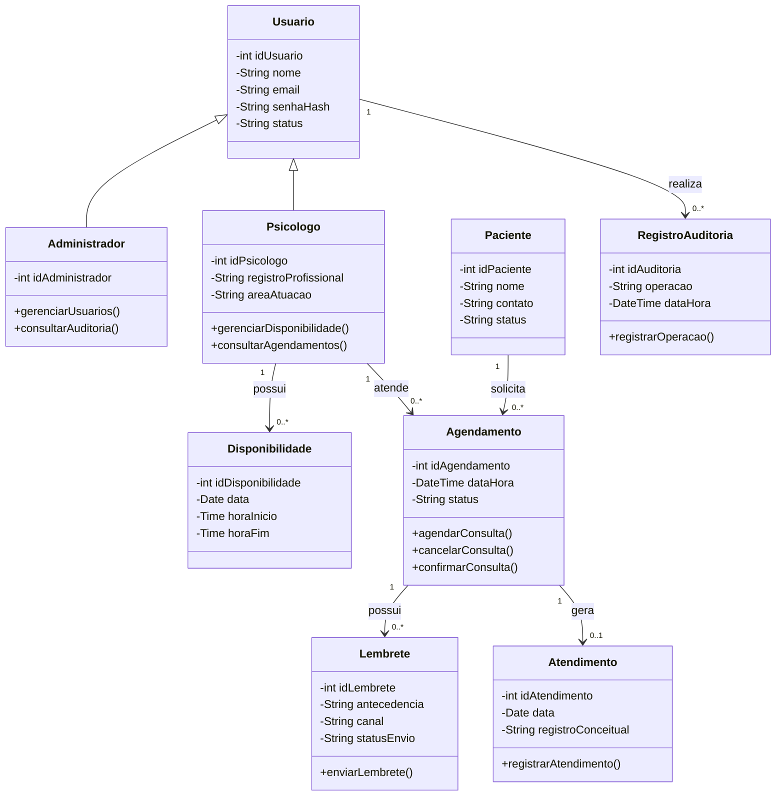
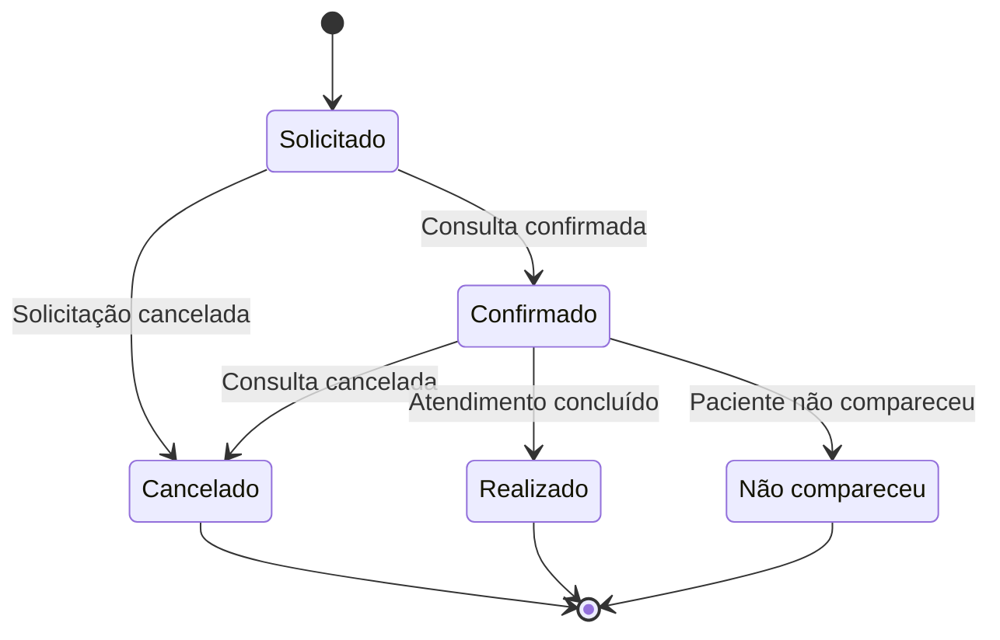
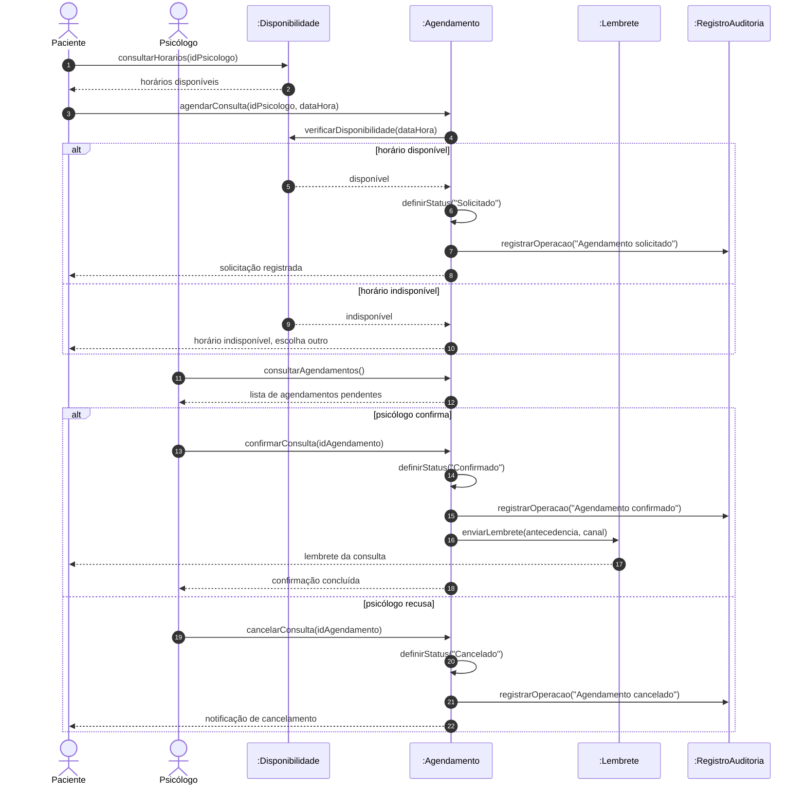

# AV3-PsiConnect

Projeto acadêmico desenvolvido para a avaliação AV3 da disciplina de Análise Orientada a Objetos.

O **PsiConnect** é uma proposta de plataforma voltada à organização de informações de psicólogos, pacientes, disponibilidades, agendamentos e lembretes de consultas.

## 1. Diagrama de Classes

O diagrama de classes representa a estrutura do PsiConnect, apresentando suas principais classes, atributos, operações e relacionamentos.

## 2. Diagrama de Estados — Agendamento

O diagrama de estados representa o ciclo de vida de um agendamento, desde a solicitação até sua confirmação, cancelamento, realização ou registro de não comparecimento.

## 3. Diagrama de Sequência — Agendar e Confirmar Consulta

O diagrama de sequência representa a ordem temporal das mensagens trocadas entre os objetos no cenário de agendamento e confirmação de uma consulta, incluindo a verificação de disponibilidade, a confirmação ou recusa pelo psicólogo e o envio do lembrete.

## 4. Diagrama de Comunicação — Agendar e Confirmar Consulta

O diagrama de comunicação representa o mesmo cenário do diagrama de sequência, enfatizando os vínculos entre os objetos e a numeração sequencial das mensagens. Como o Mermaid não possui sintaxe nativa para diagramas de comunicação, ele foi representado com `flowchart`, usando objetos como nós e mensagens numeradas nas setas.

