# PsiConnect

## Projeto de Modelagem Orientada a Objetos

O **PsiConnect** é uma plataforma proposta para auxiliar a gestão de atividades relacionadas ao atendimento psicológico, contemplando profissionais, pacientes, vínculos, disponibilidade, agendamentos, lembretes por e-mail, registros conceituais de atendimento e auditoria.

Este repositório reúne os artefatos desenvolvidos para a disciplina **Análise Orientada a Objetos**, incluindo o dossiê técnico, os diagramas UML em formato editável, o modelo de persistência e os materiais complementares do projeto.

> Todos os nomes, registros profissionais, contatos e demais informações utilizados nos exemplos são fictícios e possuem finalidade exclusivamente acadêmica.

---

## Integrantes

- Davi Rocha Lopes Lima
- Ícaro José Sousa do Carmo
- João Pedro Mascarenhas
- João Vitor Souza
- Pedro Lucas Pinho

---

## Objetivo do projeto

O objetivo do PsiConnect é representar, por meio da Análise Orientada a Objetos, uma solução capaz de centralizar e organizar:

- Usuários;
- Perfis e permissões;
- Psicólogos;
- Pacientes;
- Vínculos profissionais;
- Disponibilidade dos psicólogos;
- Agendamentos;
- Confirmações e cancelamentos;
- Lembretes por e-mail;
- Registros conceituais de atendimento;
- Auditoria das operações.

---

## Escopo

O escopo do PsiConnect contempla:

- Autenticação de usuários;
- Controle de acesso por perfis e permissões;
- Gerenciamento de usuários;
- Gerenciamento de psicólogos;
- Gerenciamento de pacientes;
- Gerenciamento de vínculos entre psicólogos e pacientes;
- Gerenciamento da disponibilidade dos psicólogos;
- Criação, confirmação e cancelamento de agendamentos;
- Consulta da agenda;
- Configuração e envio de lembretes por e-mail;
- Registro do resultado das tentativas de envio;
- Registro conceitual de atendimentos;
- Consulta de auditoria;
- Consulta de informações pelo paciente.

Não fazem parte do escopo:

- Diagnóstico automatizado;
- Prescrição de medicamentos;
- Teleconsulta;
- Pagamentos;
- Prontuário clínico completo;
- Substituição do julgamento profissional.

---

## Estrutura sugerida do repositório

```text
PsiConnect/
├── docs/
│   ├── PsiConnect_AV3.docx
│   └── PsiConnect_AV3.pdf
├── diagramas/
│   ├── editaveis/
│   │   ├── contexto
│   │   ├── casos-de-uso
│   │   ├── classes
│   │   ├── objetos
│   │   ├── sequencias
│   │   ├── comunicacao
│   │   ├── atividades
│   │   ├── estados
│   │   ├── pacotes
│   │   ├── componentes
│   │   ├── implantacao
│   │   └── der
│   └── exportados/
├── modelo-dados/
│   ├── DER
│   └── dicionario-de-dados
├── video/
│   ├── roteiro
│   └── link-do-video
└── README.md
```

---

# Diagramas do Sistema

Os diagramas apresentados a seguir representam a modelagem proposta para o sistema PsiConnect.

---

## 1. Diagrama de Contexto

O diagrama de contexto apresenta os principais atores externos e suas interações com o sistema.

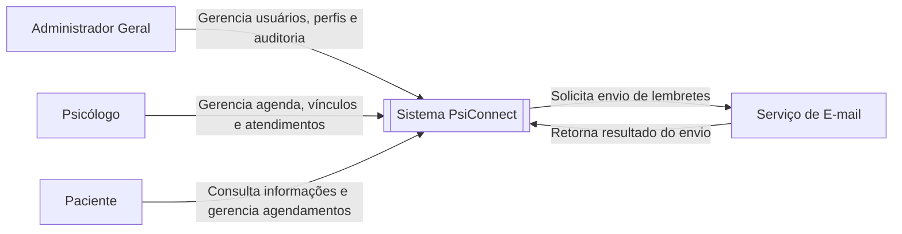

---

## 2. Diagrama de Casos de Uso

O diagrama apresenta as funcionalidades disponibilizadas para cada ator.

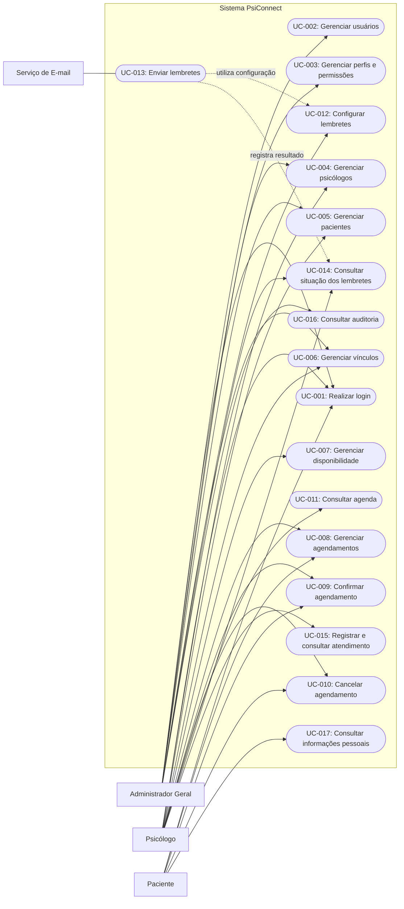

---

## 3. Diagrama de Classes

O diagrama de classes representa as entidades principais, seus atributos, operações e relacionamentos.

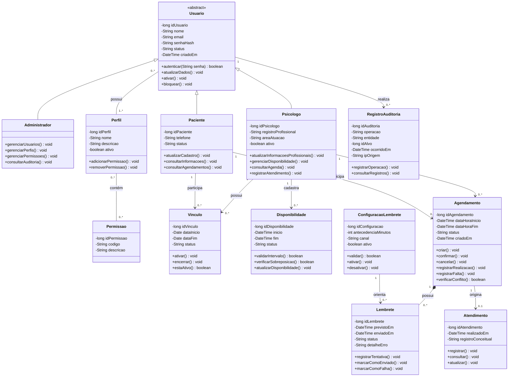

---

## 4. Diagrama de Objetos

O diagrama apresenta exemplos fictícios de instâncias das classes do sistema.

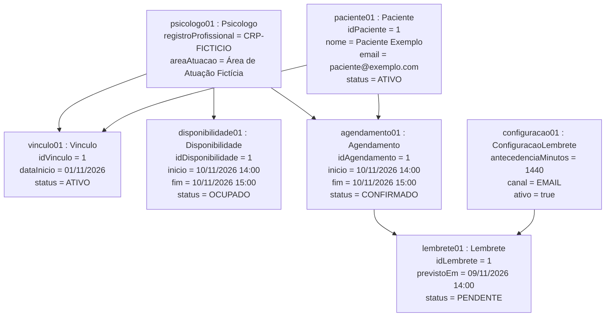

---

# Diagramas de Sequência

## 5. Diagrama de Sequência: Realizar Login

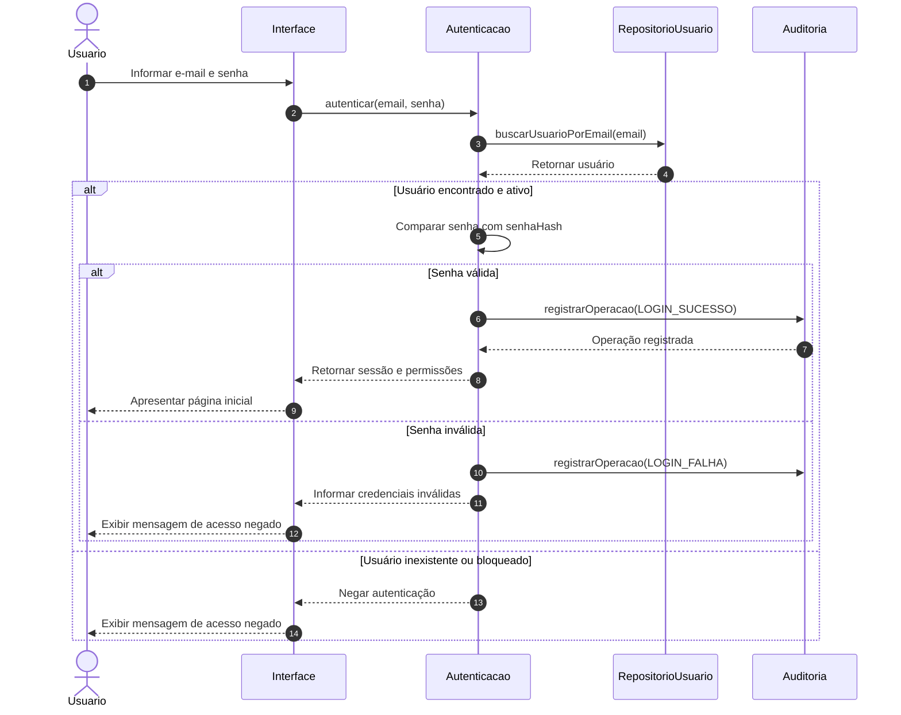

---

## 6. Diagrama de Sequência: Agendar Consulta

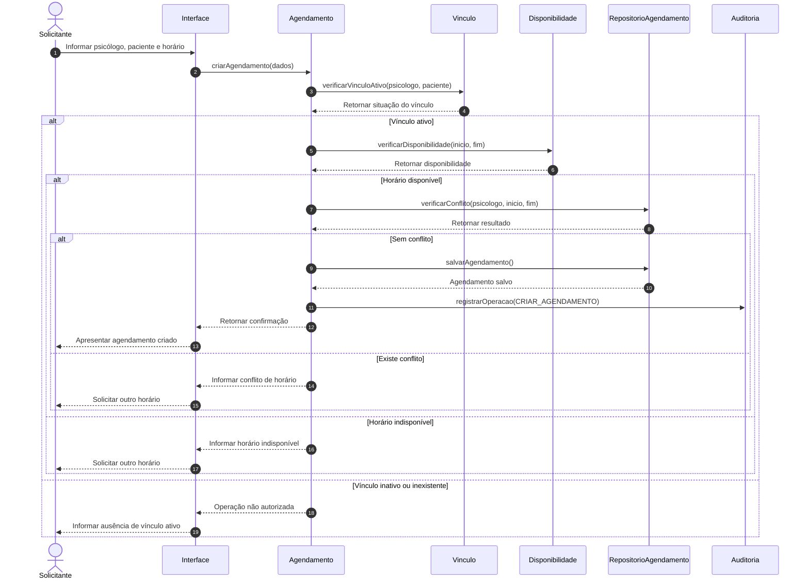

---

## 7. Diagrama de Sequência: Enviar Lembrete

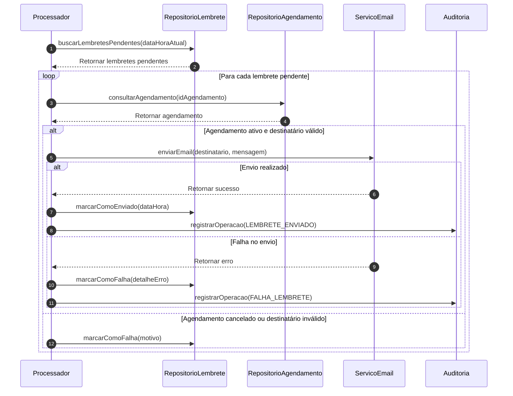

---

## 8. Diagrama de Comunicação

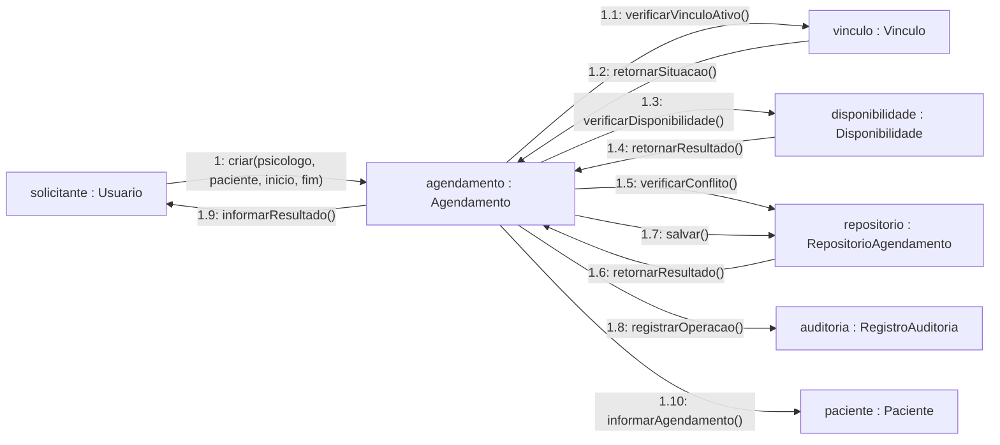

---

## 9. Diagrama de Atividades

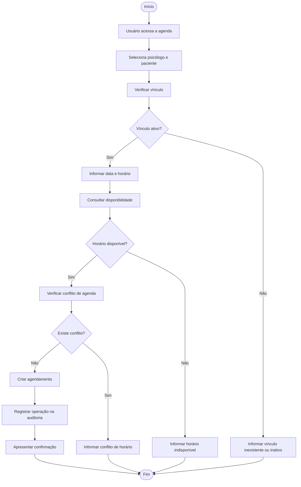

---

## 10. Diagrama de Estados do Agendamento

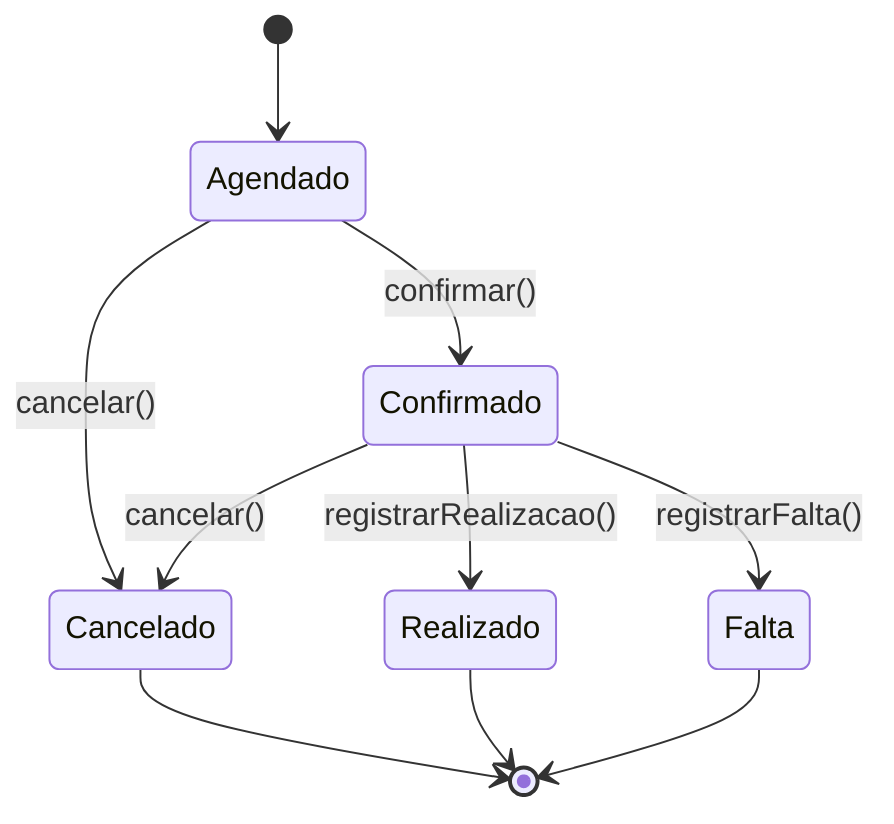

### Estados possíveis

- **Agendado:** agendamento criado, aguardando confirmação;
- **Confirmado:** agendamento confirmado;
- **Cancelado:** agendamento cancelado;
- **Realizado:** atendimento realizado;
- **Falta:** paciente não compareceu ao atendimento.

---

## 11. Diagrama de Pacotes

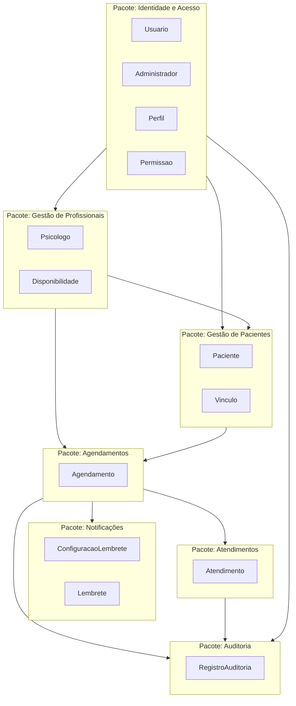

---

## 12. Diagrama de Componentes

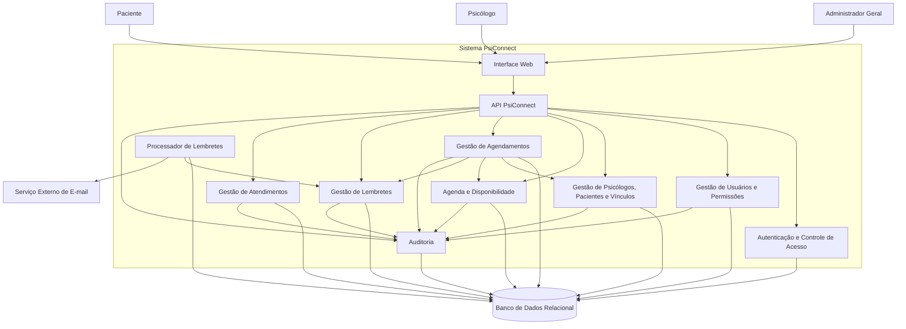

---

## 13. Diagrama de Implantação

O diagrama de implantação apresenta os nós físicos e serviços envolvidos na execução da solução.

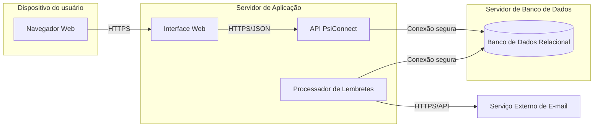

---

# Modelo de Persistência

## 14. Diagrama Entidade-Relacionamento

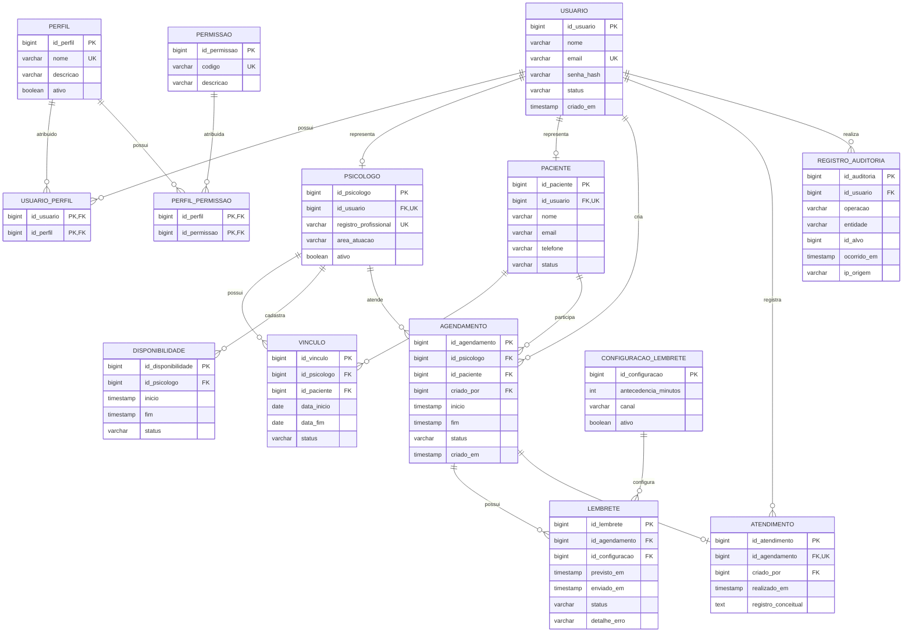

---

## 15. Regras de Integridade do Banco de Dados

O modelo de persistência deverá respeitar as seguintes regras:

1. O e-mail do usuário deve ser único.
2. O registro profissional do psicólogo deve ser único.
3. Todo psicólogo deve estar relacionado a um usuário.
4. O paciente pode estar relacionado a um usuário para acesso ao sistema.
5. Todo vínculo deve relacionar um psicólogo e um paciente.
6. A data final do vínculo não pode ser anterior à data inicial.
7. O horário final da disponibilidade deve ser posterior ao horário inicial.
8. O horário final do agendamento deve ser posterior ao horário inicial.
9. Um psicólogo não pode possuir agendamentos confirmados sobrepostos.
10. Todo agendamento deve estar relacionado a um psicólogo e um paciente.
11. Todo lembrete deve estar relacionado a um agendamento.
12. Um atendimento só pode ser registrado para agendamento realizado.
13. Cada agendamento pode possuir no máximo um atendimento.
14. Operações críticas devem gerar um registro de auditoria.
15. Exclusões de usuários, psicólogos e pacientes devem ser preferencialmente lógicas.

---

# Regras de Negócio Principais

- **RN-001:** somente usuários ativos e autorizados podem acessar o sistema.
- **RN-002:** o e-mail do usuário e o registro profissional devem ser únicos.
- **RN-003:** o psicólogo pode acessar apenas pacientes com vínculo ativo.
- **RN-004:** todo agendamento deve ocorrer dentro da disponibilidade do psicólogo.
- **RN-005:** não são permitidos agendamentos confirmados sobrepostos.
- **RN-006:** o cancelamento deve alterar a situação e liberar o intervalo.
- **RN-007:** somente agendamentos ativos podem ser confirmados ou cancelados.
- **RN-008:** lembretes devem ser enviados somente para agendamentos ativos.
- **RN-009:** cada tentativa de envio deve gerar um registro de resultado.
- **RN-010:** o atendimento só pode ser registrado para um agendamento realizado.
- **RN-011:** operações críticas devem gerar registros de auditoria.
- **RN-012:** todos os dados utilizados no projeto devem ser fictícios.
- **RN-013:** o paciente pode consultar apenas as próprias informações.
- **RN-014:** senhas devem ser armazenadas por meio de hash seguro.
- **RN-015:** exclusões lógicas devem preservar o histórico do sistema.

---

# Arquitetura Proposta

A arquitetura do PsiConnect está dividida nas seguintes camadas:

## Camada de apresentação

Responsável pela interação com os usuários por meio da interface web.

## Camada de aplicação

Responsável pela coordenação dos casos de uso, autenticação, validações e controle das operações.

## Camada de domínio

Responsável pelas entidades, regras de negócio, estados, relacionamentos e comportamentos do sistema.

## Camada de infraestrutura

Responsável pela persistência, conexão com o banco de dados, auditoria e integração com o serviço externo de e-mail.

---

# Tecnologias de Modelagem

Os artefatos do projeto utilizam:

- UML 2.x;
- Mermaid;
- Markdown;
- Modelo relacional;
- Git;
- GitHub.

---

# Visualização dos Diagramas

Os diagramas Mermaid podem ser visualizados diretamente no GitHub.

Os arquivos editáveis também devem ser mantidos no diretório:

```text
diagramas/editaveis/
```

As versões exportadas em PNG ou PDF devem ser mantidas no diretório:

```text
diagramas/exportados/
```

---

# Documento do Projeto

O documento completo do projeto está disponível no diretório:

```text
docs/
```

O diretório deve conter:

- Documento editável em formato DOCX;
- Documento final em formato PDF.

---

# Vídeo-pitch

O roteiro e o link do vídeo-pitch deverão ser disponibilizados no diretório:

```text
video/
```

O vídeo deverá apresentar resumidamente:

1. O problema identificado;
2. A proposta do PsiConnect;
3. Os principais atores;
4. As funcionalidades;
5. Os diagramas mais importantes;
6. O modelo de persistência;
7. A arquitetura;
8. Os benefícios esperados.

---

# Considerações Finais

O PsiConnect apresenta uma proposta de modelagem integrada para organização de usuários, profissionais, pacientes, vínculos, disponibilidade, agendamentos, lembretes, atendimentos e auditoria.

Os artefatos deste repositório foram organizados para manter a rastreabilidade e a coerência entre requisitos, regras de negócio, casos de uso, classes, interações, arquitetura e persistência.

O projeto possui finalidade exclusivamente acadêmica e não utiliza dados reais de pacientes ou profissionais.
