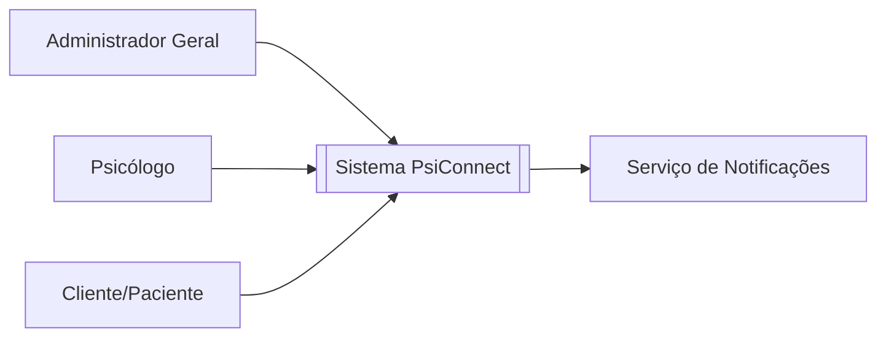
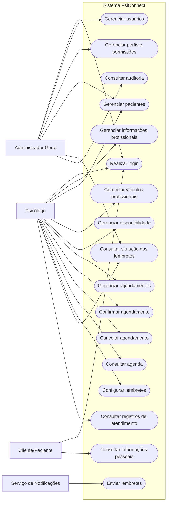
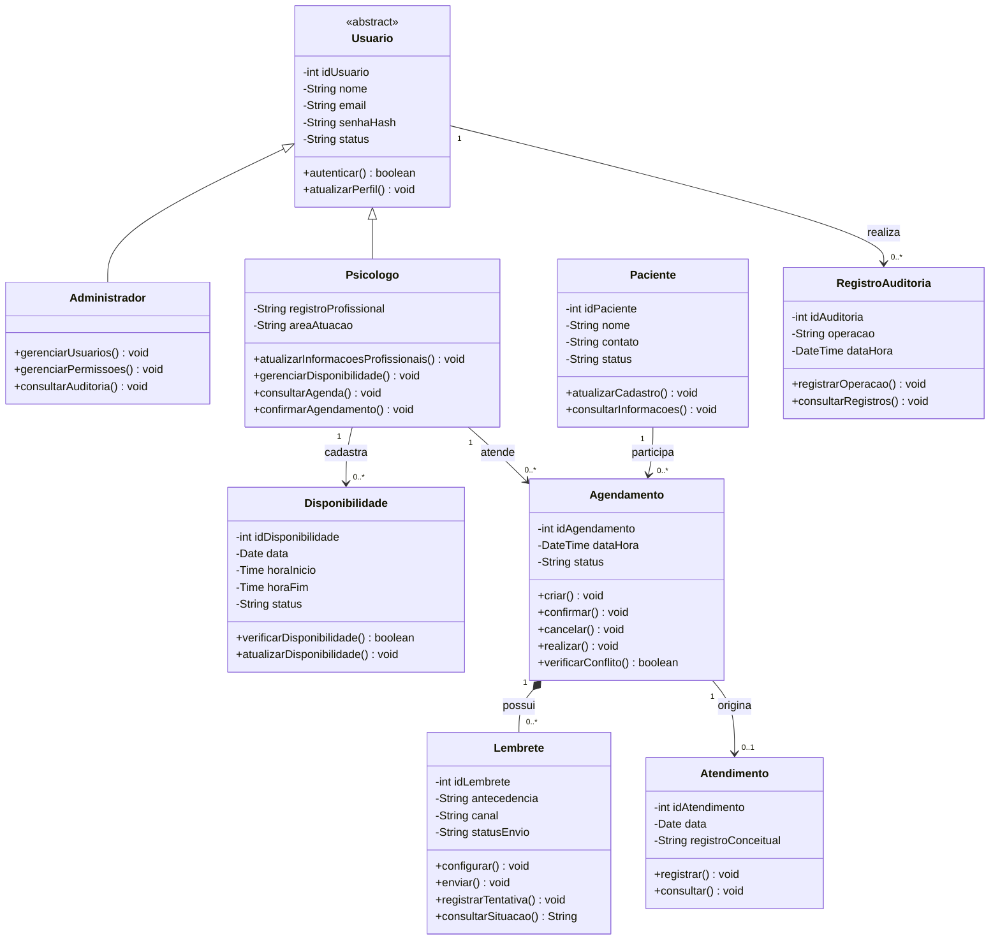
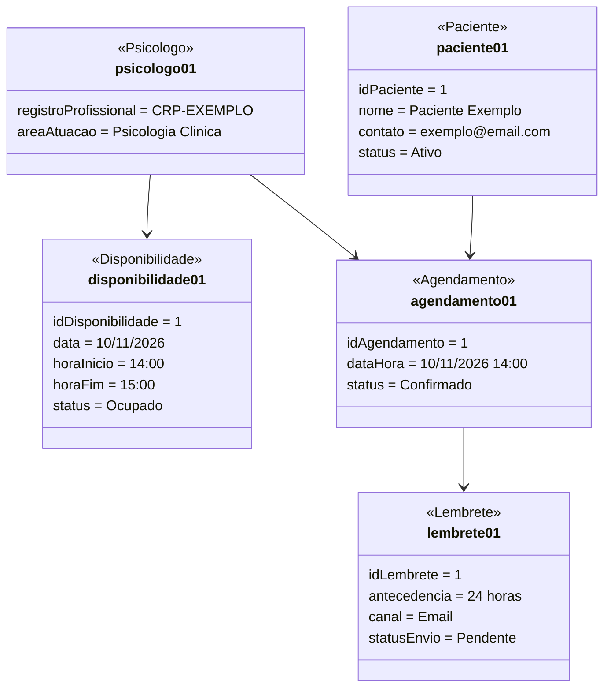
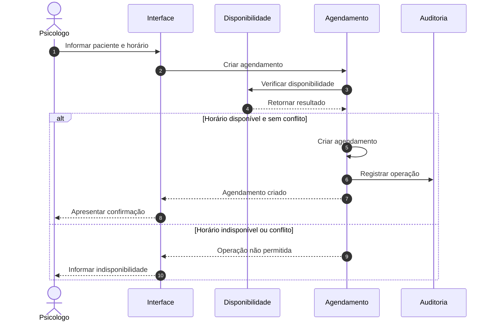
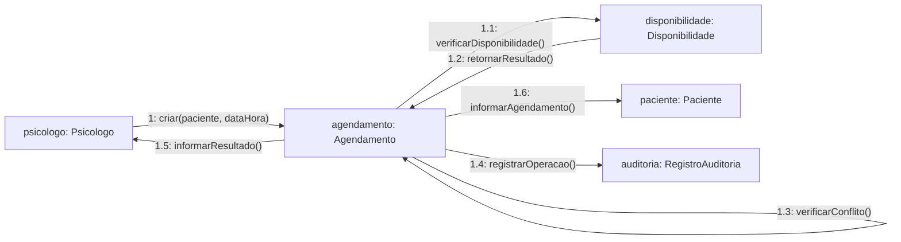
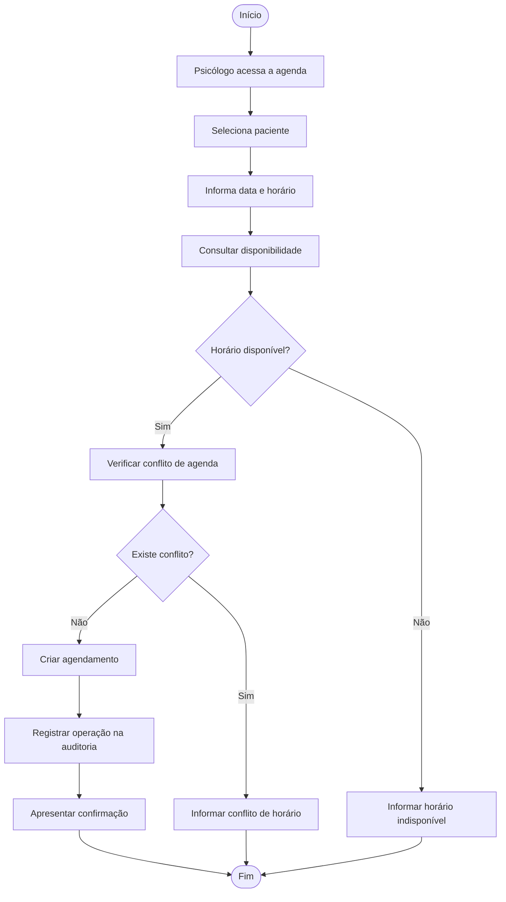
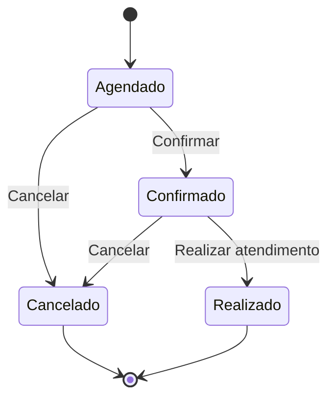
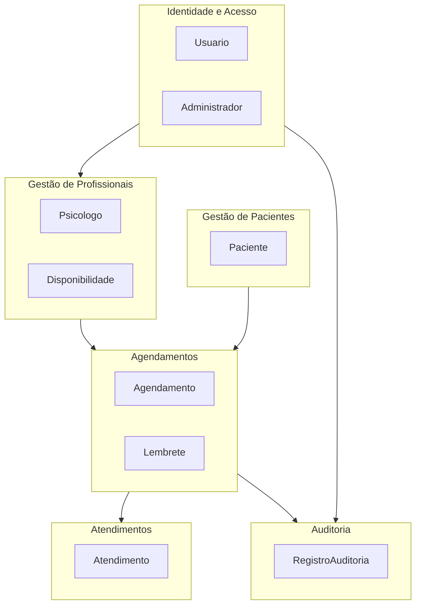
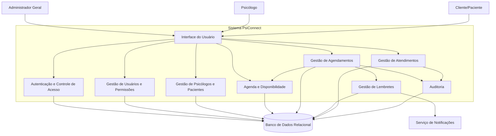

# PsiConnect

## Projeto de Modelagem Orientada a Objetos

O PsiConnect é uma plataforma proposta para auxiliar a gestão de atividades relacionadas ao atendimento psicológico, contemplando profissionais, pacientes, disponibilidade, agendamentos, lembretes, registros de atendimento e auditoria.

# Diagramas do Sistema

Os diagramas abaixo representam a modelagem proposta para o sistema PsiConnect.

---

## 1. Diagrama de Contexto

---

## 2. Diagrama de Casos de Uso

---

## 3. Diagrama de Classes

---

## 4. Diagrama de Objetos

---

## 5. Diagrama de Sequência

---

## 6. Diagrama de Comunicação

---

## 7. Diagrama de Atividades

---

## 8. Diagrama de Estados

---

## 9. Diagrama de Pacotes

---

## 10. Diagrama de Componentes

